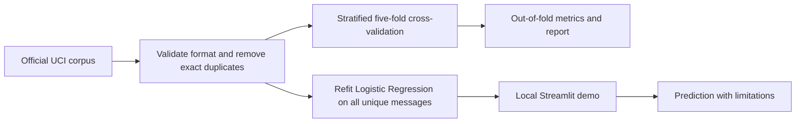

# English SMS Spam Classification

[](https://www.python.org/)
[](LICENSE)

A reproducible text-classification study and local Streamlit demo for labeling English SMS messages as `spam` or `ham`. The dataset has no separate scam or fraud label, so this project does **not** claim to detect scams or guarantee safe messages.

## What this project includes

- A documented public dataset source, license, attribution, and data limitations.
- A fixed, transparent keyword/URL rule baseline.
- Two classical text models: Multinomial Naive Bayes and Logistic Regression with TF-IDF word unigrams and bigrams.
- Stratified five-fold cross-validation, out-of-fold metrics, fold-level variation, and confusion matrices.
- A small local app for entering a message and viewing a model prediction with clear limitations.

## Research question

Across stratified five-fold cross-validation on the UCI SMS Spam Collection, how do the rule baseline, Multinomial Naive Bayes, and Logistic Regression compare on precision, recall, and F1 for the `spam` class?

The protocol and measured findings are in [docs/EXPERIMENT.md](docs/EXPERIMENT.md) and [reports/RESULTS.md](reports/RESULTS.md). The measured report is generated by the training script; it is not a claim about every SMS filter or current threat patterns.

## Results

The table shows pooled out-of-fold metrics. Fold F1 is the mean and sample standard deviation across folds.

| Method | Precision (spam) | Recall (spam) | Pooled F1 (spam) | Fold F1 mean ± SD | Accuracy |
|---|---:|---:|---:|---:|---:|
| Rule baseline | 0.780 | 0.591 | 0.672 | 0.673 ± 0.027 | 0.927 |
| Multinomial Naive Bayes | 1.000 | 0.518 | 0.682 | 0.682 ± 0.015 | 0.939 |
| Logistic Regression | 0.998 | 0.677 | 0.807 | 0.806 ± 0.020 | 0.959 |

See [reports/RESULTS.md](reports/RESULTS.md) for per-fold metrics and confusion matrices. These measurements describe this historical corpus and cross-validation setup; fold standard deviation is not a confidence interval, and cross-validation does not establish performance on current messages, other languages, or scam detection.

## Workflow



## Dataset and licensing

The project uses the [UCI SMS Spam Collection](https://archive.ics.uci.edu/dataset/228/sms%2Bspam%2Bcollection), an English corpus with 5,574 labeled rows. UCI identifies the dataset license as CC BY 4.0. The source combines older message collections and uses only the labels `ham` and `spam`; details and attribution are recorded in [DATASET.md](DATASET.md).

The raw corpus is not committed to this repository. Run the retrieval script below. Project code is MIT-licensed; the dataset keeps its separate CC BY 4.0 terms.

## Run locally

Requires Python 3.10 or newer.

```powershell
py -m venv .venv
.\.venv\Scripts\Activate.ps1
python -m pip install -r requirements.txt
python scripts/download_data.py
python -m src.train
streamlit run app.py
```

On macOS or Linux, create the environment with `python3 -m venv .venv` and activate it with `source .venv/bin/activate`.

For the exact Python 3.12 environment used for the reported results, install from `requirements.lock` instead of `requirements.txt`.

Training stores the fitted demo model under `models/`, raw cross-validation output under `reports/generated/`, and refreshes the human-readable report at `reports/RESULTS.md`. Raw data, model files, and machine-generated JSON are excluded from Git so they can be recreated from the documented source and commands.

## Repository map

```text
app.py                     Streamlit message classifier
src/pipeline.py            Data loading, duplicate handling, models, metrics
src/train.py               Five-fold evaluation, final demo-model fit, report generation
scripts/download_data.py   Download and verify the official UCI data file
requirements.lock          Exact environment used for the reported experiment
docs/EXPERIMENT.md         Research question and evaluation protocol
docs/RESUME_AND_INTERVIEW.md Honest resume and interview wording
reports/RESULTS.md         Measured cross-validation results
DATASET.md                 Citation, license, provenance, and inspection record
```

## Limitations

- English SMS only, from one historical dataset with source-specific vocabulary and class balance.
- `spam` is not a verified scam/fraud label.
- The app displays a model probability that has not been calibrated; it can be wrong.
- A message predicted as `ham` can still be dangerous. Verify suspicious requests through official channels.
- Results are educational research estimates, not a deployed security service.

## Resume wording

A concise, evidence-based resume bullet and interview explanation are in [docs/RESUME_AND_INTERVIEW.md](docs/RESUME_AND_INTERVIEW.md). They should be updated if the experiment or results change.
